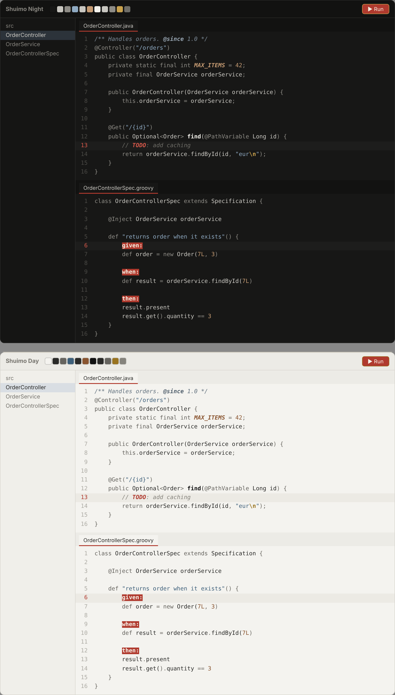

# Shuimo

Dark and light themes based on Chinese ink-wash painting (水墨, *shuimo*). Hierarchy comes from ink tone and weight, not hue: declarations are darkest and bold, plain names are mid ink, keywords recede. Indigo (strings) and ochre (numbers, constants) are the only washes, and a red seal marks Spock labels, the caret and TODOs. Provides two UI themes, **Shuimo Night** and **Shuimo Day**, each with a matching editor colour scheme.



## Develop

Palettes and all colour mappings are in `gen.py`. The root `build.py` includes the themes in the Heritage Themes plugin; see the [root README](../README.md) for build and install steps.

Generate a palette preview at `shuimo/build/preview.html`:

```bash
python3 shuimo/gen.py
```
