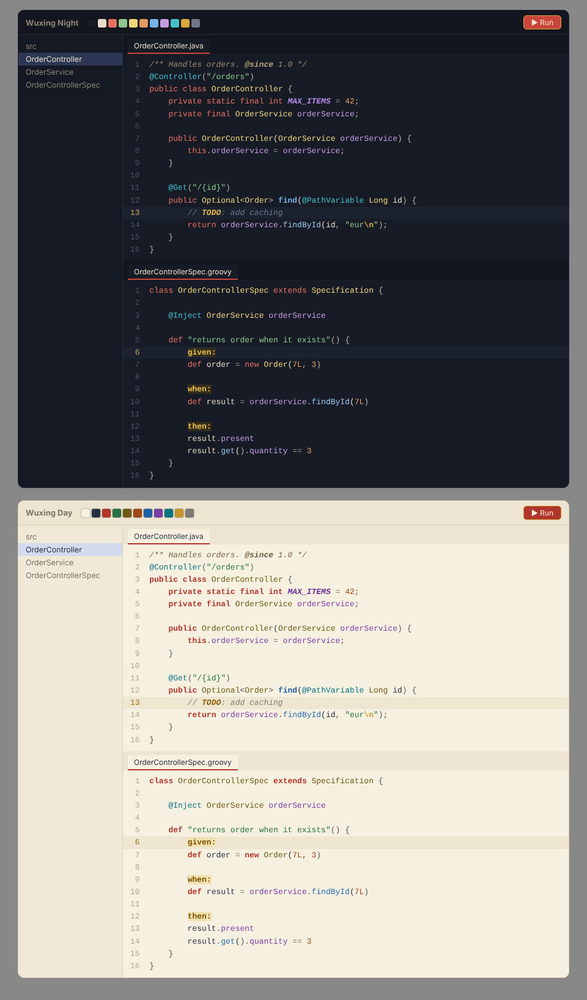

# Wuxing

Dark and light themes based on Chinese colour symbolism and the Five Elements (Wuxing). Provides two UI themes, **Wuxing Night** and **Wuxing Day**, each with a matching editor colour scheme.



## Build

Requires Python 3.

```bash
python3 wuxing/gen.py
```

Output in `wuxing/build/`:

| Path | Content |
| --- | --- |
| `wuxing-themes-1.0.0.jar` | Installable plugin |
| `Wuxing Day.icls`, `Wuxing Night.icls` | Standalone editor schemes |
| `preview.html` | Palette preview |

## Install

- Plugin: **Settings | Plugins | ⚙ | Install Plugin from Disk…**, select the jar, restart the IDE, then choose the theme under **Settings | Appearance & Behavior | Appearance | Theme**.
- Editor scheme only: **Settings | Editor | Color Scheme | ⚙ | Import Scheme…**, select an `.icls` file.

## Develop

Palettes and all colour mappings are in `gen.py`. Plugin metadata (id, version, supported IDE builds) is the `plugin.xml` template written after the theme generation loop in `gen.py`. Change the version there before tagging a release.
